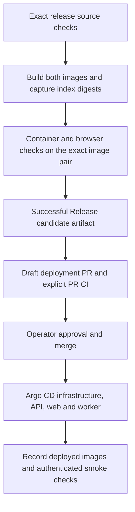

# Deployment operations

## Release and deployment are separate

A source tag or GitHub Release is not deployment approval. The Release workflow can publish source before an image build fails. Argo CD compares Git state, not the contents behind `latest`.

The deployment candidate contains one source commit, one stable version, and two multi-platform image index digests. Digests remain fixed across tag rebuilds. The API, its migration initContainer, and the optional alert worker use the same API digest.



Release is the only Docker publication entry point. It validates the selected commit through source CI once before source/image publication. Docker then builds both images and runs container/browser checks against the recorded digests; it does not call source CI again or rebuild the tested pair. Failed checks, a partial pair, or a cancelled Release cannot produce an approved candidate. Independent PR/main CI remains in place. Recover images with `release.yml` and `operation=retry-publication`, not a direct Docker run or a tag push.

Docker no longer updates `latest`. Existing installations that track `latest` do not receive new images until an operator adopts an approved pinned release. This change does not modify an existing Application.

`.github/workflows/promote.yml` reads only a successful main-branch Release run from this repository. It uses current main tooling, not artifact scripts. It checks the run, attempt, source ancestry, version, and both digests. It opens a draft PR with exactly these files:

- `deploy/gitops/logice.json`: child Argo CD Application with a pinned chart commit and image digests.
- `deploy/gitops/release.json`: source and validation evidence.

The workflow has repository permissions but no cluster credentials. It never syncs Argo CD or merges a PR. It explicitly dispatches `ci.yml` on the generated branch because `GITHUB_TOKEN` PR creation does not trigger PR CI.

## Recover a mixed-version installation

A successful login does not prove that the API supports projects. If the web image supports projects but the API image predates them, the project list fails and the creation form is hidden. Argo CD can still report Healthy because the older API passes its liveness probe.

1. Compare the running API and web image digests and their `org.opencontainers.image.revision` labels. Both must come from the same tested release commit; matching `latest` tags are not evidence of matching source.
2. Use read-only schema checks to confirm the required project tables. A successful migration initContainer only proves that its own image applied its embedded schema. Do not add tables manually or rerun the old migration image as a repair.
3. If the fix is already on `main` but not in a release, add a change note and review the generated release PR. Require a successful Release run with a deployment candidate. A successful no-op run without that artifact does not qualify, and retrying an older saved batch does not include later fixes.
4. Review the generated draft deployment PR, then complete the adoption and operator gates below. The API, migration container, and web must use the approved image pair. Merging a release PR alone does not update an existing `latest` installation.

Keep the current deployment unchanged until those gates pass. Do not use a future tag, a failed image pair, or a restart of `latest` as a substitute for promotion.

## One-time adoption: operator gate

**This source change does not modify the existing live Application.** An Application that still reads `charts/logice` at `HEAD` with `latest` will keep the old deployment behavior. Adoption is a separate, approved cluster change.

1. Configure required checks and code-owner approval for `main`. Require an up-to-date branch or a merge queue. Require the deployment check as well as the application CI checks. The path-filtered Tooling workflow is optional for unrelated PRs and must not be a required check.
   - Protect `deploy/gitops/`, deployment tooling, and workflows through the existing code owner.
   - Do not permit an old green check to authorize a stale deployment PR.
   - Do not enable auto-merge for deployment PRs.
2. Enable Actions PR creation and workflow dispatch permissions. These GitHub settings are external prerequisites, not established by repository tests.
3. Review the generated child Application before adoption.
   - It uses AppProject `private`, namespace `logice`, Helm release `logice`, and the chart defaults for origin, Secrets, storage, and routing.
   - Confirm these values match the installation. Do not change release name or namespace over existing PVCs.
   - Confirm registry pull access and every required Secret key. Keep credentials out of Git.
4. Select the first candidate only from a release that contains digest rendering and `/api/readyz`. Old releases cannot satisfy these contracts.
5. Complete the operator approval checklist below before adopting [the parent Application](../charts/argocd-gitops-parent.example.yaml).
   - The parent reads `deploy/gitops` on `main` and includes only `logice.json`.
   - The parent manages the existing child `logice` Application. Remove any competing owner or external override through the existing GitOps source.
   - Limit the parent's AppProject and credentials to the required repository and Application destination. Application management is a privileged control.
   - The child pins the tested chart commit. Ordinary chart changes on main cannot bypass promotion after adoption.
   - The parent has no prune or deletion finalizer. The child retains the chart's PVC retention controls.
6. Record the parent and child desired sources and compare them with the approved deployment record. Only then enable the approved sync.

No deployable child Application is included in the implementation PR. The first generated deployment PR requires separate review. Do not apply the example merely to validate its syntax.

## Required operator approval

Before marking a deployment PR ready and merging it:

1. Inspect the source commit, chart changes, both digests, successful Release run, and current PR CI. The candidate artifact expires after 30 days.
2. Back up PostgreSQL, ClickHouse, and the encryption key. Record a successful disposable restore test. Keep key material separate from database backups.
3. Record physical user-verifying Passkey tests on the intended HTTPS origin, including browser/platform, UTC date, login, backup credential, removal, and session outcomes.
   - [The Passkey plan](plans/2026-10-24_passkey-management-plan.md) has an open physical-device gate. CI and virtual authenticators do not close it.
4. Check image pull access, Secret references, PVC access, origin, private routing, and NetworkPolicy enforcement.
5. Select a schema-compatible recovery target or a forward-fix procedure. Approve the expected API outage and any ingestion interruption.
6. Check old-browser/new-API compatibility. Ordered deployment does not reload existing browser tabs.

## Rollout and acceptance

Argo CD sync waves have these roles:

| Wave | Resources | Acceptance |
| --- | --- | --- |
| 0 | Services, configuration, storage, PostgreSQL, ClickHouse, Collector, network controls | Required resources exist and workloads are healthy |
| 1 | API Deployment | Image pulls; matching initContainer completes migration; API becomes ready |
| 2 | Web and optional alert worker | API is ready before these workloads update |

Keep normal full sync. A selective sync can skip dependencies and is not this rollout procedure. A resource failure in an earlier wave must stop later waves. Confirm this behavior on the installed Argo CD version during first adoption.

Digest-promoted API images use `/api/readyz`. Tag-only chart installations retain their previous `/api/healthz` probe until deliberate adoption. This avoids adding a new probe to an old API when an existing Application still tracks the chart on HEAD. Tag-only mode is not accepted by the promotion workflow.

The API remains one replica with `Recreate`. The old Pod stops before migration starts. This is an ordered rollout with downtime, not an atomic or zero-downtime deployment. The existing transactional migration runner and PostgreSQL advisory lock remain the only migration mechanism.

`/api/healthz` remains process liveness. `/api/readyz` checks exact PostgreSQL schema versions and configured ClickHouse access. It has a two-second request deadline, one active check, no queue, and generic GET/HEAD responses. Storage errors remove readiness without changing liveness. The endpoint does not prove login, authorization, ingestion, or application compatibility.

After an approved sync, record all of these results:

1. Argo CD uses the approved chart commit and both desired image references. Deployment generations are observed, and all required Pods are ready.
2. API, migration, web, and enabled worker use the expected images. Kubernetes can report a platform-specific image digest rather than the multi-platform index digest. Verify that the reported digest belongs to the approved index; do not compare different digest types as if they were identical.
3. With a disposable account on the intended HTTPS origin, sign in, list projects, create a disposable project, and open its dashboard and settings. Remove the disposable project after the check.
4. Unauthenticated project access is rejected. Verify project-scoped OTLP ingestion and queries with disposable telemetry.
5. Check errors, ingestion interruption, and migration status without recording credentials, invitations, cookies, or telemetry payloads.

A failed smoke check is a failed deployment even if Argo CD reports Healthy. Stop further promotion, restrict affected access if necessary, and use the recovery procedure. Automated CI cannot claim these live results.

## Failure handling and retry

- **One image fails or CI fails:** no deployment candidate is published. GitOps state stays unchanged.
- **Image pull fails:** startup cannot complete. Do not replace the digest with `latest` or bypass readiness.
- **Migration or readiness fails:** wave 1 blocks wave 2. Recreate means the API may remain unavailable. Diagnose storage, schema, Secret references, and image compatibility before retry.
- **Old browser calls fail:** investigate API compatibility. A web rollout does not replace already loaded JavaScript.
- **Source publication succeeds but images fail:** inspect Release and both builds. Retry the complete Release workflow only after operator approval. Use **Re-run all jobs**, not only failed matrix jobs; image records must come from one attempt.
- **PR creation or CI dispatch fails:** the workflow fails visibly. A promotion retry reuses the same branch and PR without force-pushing. It does not discard the pending result.
- **A candidate is stale:** lower versions and changed content under an already promoted version are rejected. A pending PR cannot overwrite another candidate's branch. CI compares deployment changes with current main and successful Release evidence.
- **A candidate is rebuilt:** if an existing proposal has different evidence, use a new version. Do not move tags, rewrite a proposal, or bypass the digest checks.
- **A candidate expires:** obtain a new validated release candidate. Do not delete the deployment record to bypass validation.

To retry only PR creation or CI dispatch for a successful Release run:

```sh
gh workflow run promote.yml --ref main -f release-run=RELEASE_RUN_ID
```

This command does not publish images or contact a cluster. It still needs authorization to modify the repository. The implementation tests use a fake GitHub API and do not execute this command.

## Recovery and schema compatibility

A Git revert does not roll back stored data. Exact schema checks intentionally reject unknown future versions. An additive migration alone does not prove that an older binary can restart.

No automatic image or database rollback is provided. Prefer a new forward-fix release. If restoring prior application code, package it as a new recovery release with a higher version, preserve the required schema contract, and test it against a copy of the upgraded database. Promote the tested pair through the same review path.

If no application image can use the database safely, isolate access and use a separately approved restore procedure. A stale backup can restore revoked sessions or credentials. Follow [Passkey recovery](passkey-operations.md#backup-and-restore) before reopening access. Never drop authentication/project tables, erase audit data, weaken version checks, or restore an unscoped reader to force startup.

To stop deployment automation, stop the parent from applying new child state through its operator-controlled configuration. Disabling promotion alone prevents new PRs but does not stop an adopted Argo CD Application from reconciling an already merged deployment.

## Local checks

```sh
uv run tests/deployment/check.py
uv run charts/logice/tests/check.py
uv run tests/release/check.py
actionlint .github/workflows/*.yml
sh scripts/check-go.sh
npm --prefix web run ci
sh scripts/validate-compose-web.sh
```

Deployment fixture tests cover invalid and partial image pairs, failed/cancelled runs, artifact expiry and attempt binding, stale versions, draft PR creation, exact two-file updates, retry behavior, dispatch failures, and pull/startup cleanup. Go tests cover readiness admission, deadlines, cancellation, methods, generic errors, and schema rollback rejection. Real-service tests remain separate from live operator acceptance.
