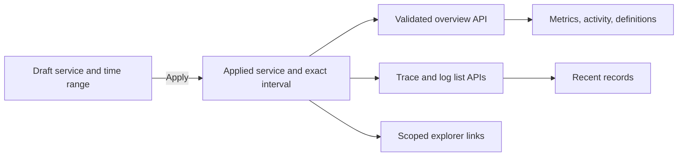

# Dashboard UX

## Review

The review used commit `081d583`, local Vite, and synthetic API fixtures. It covered populated and empty Dashboards at 1440px and 390px, plus Traces, Logs, and Live. It did not verify backend integration.

The Dashboard has the largest remaining investigation delay:

- Recent-record panels start at 917px on desktop and 1,491px on mobile in the representative populated fixture.
- Six large metrics and long definitions appear before the records.
- Time and service controls form separate blocks. Pending edits and the applied query do not appear together.
- The existing 60 aggregate buckets appear only in a collapsed table.
- Setup actions appear after empty recent-record panels rather than near the empty state.

The earlier mobile-navigation and control-size fixes are retained from PR #36.

## Visual Proposal

`codex_imagegen` generated a desktop/mobile design board at `/tmp/logice-dashboard-ux-proposal.png`. The prompt used synthetic names and counts only. The image is a temporary reference, not a runtime asset, and is not committed.

Adopted ideas:

- One compact query bar with explicit Apply and Refresh actions.
- Four primary metrics in one desktop row and two mobile columns.
- A shallow trace/error activity chart before recent records.
- Clear recent-record headings and explorer links.
- A small connection shortcut instead of a large configuration block.

Rejected ideas:

- Global search: no cross-signal search contract exists.
- Service dropdown: the Dashboard API does not provide a complete service list. Use an exact-match text field.
- Green “OK” labels: absence of a stored Error span does not prove service health.
- Sampled counts presented as totals or trend changes: full-window statistics and recent samples remain distinct.
- New shell controls: keep the existing project, language, theme, and account behavior.

## Design Contract

- Apply submits the draft service and time range together.
- Refresh uses the applied query and moves its relative interval forward. It does not apply pending edits.
- The applied service and exact UTC interval stay visible. Metric, bucket, and recent-list links preserve their project, service, and exact interval. Trace-detail links keep the exact interval and show all services in the trace.
- Primary metrics are stored traces, deduplicated stored logs, error trace proportion, and root-span p95 duration.
  - Metric definitions retain p50, conflict counts, population definitions, and snapshot limitations.
  - Missing percentiles and empty error populations remain unavailable, not zero or healthy.
- The chart shows existing trace/error bucket counts. It does not sum distinct traces across buckets.
  - Integer labels retain full precision. Graphical heights are scaled from integer ratios.
  - A keyboard-accessible table retains exact bucket values and links.
- Aggregate loading, failure, empty, and populated states remain separate.
  - Only a validated zero trace/log population produces the aggregate empty state.
  - A service-filtered empty result suggests a wider interval or another service rather than claiming that the project has no telemetry.
- Recent-record counts remain bounded samples. They are never substituted for aggregate counts.
- Setup links respect the project role. Viewers are not offered ingestion-token management.
- The layout uses existing Classic/Studio theme tokens and no new runtime dependencies.

## Data Flow

## Validation

Acceptance covers both themes, 320px/390px/1440px widths, long translated labels, exact query links, pending edits, integer chart values, null metrics, loading/error recovery, and role-specific empty-state actions. Browser layout tests use explicit fixtures; they are not backend acceptance tests.

The implementation adds `web/e2e/dashboard-ux.spec.ts` and `web/src/overview-activity.test.tsx`. Focused validation includes the existing mobile UI suite so the Dashboard changes do not regress shared navigation or Live controls.

Representative populated-fixture measurements for the start of the recent-record panels:

| Viewport width | Before | After |
| --- | --- | --- |
| 1440px | 917px | 760px |
| 390px | 1,491px | 908px |

The desktop result exposes recent records without scrolling at 1440×1000. The mobile result requires less scrolling and shows all four primary metrics before the activity chart. These measurements describe the fixture, not all possible languages or record contents.
