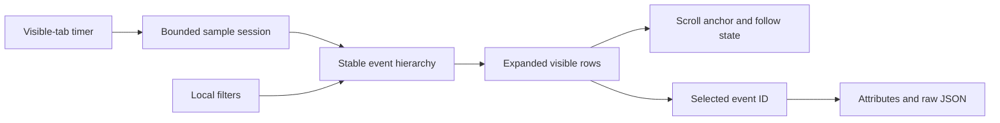

# Live explorer: design preview 01

## Goal

Show traces, spans, and correlated logs as one live hierarchy. Let the user inspect an event without leaving its parent context. The interactive preview is at `http://127.0.0.1:5173/preview` after building the web service.

This page uses **simulated data only**. It does not query ClickHouse, poll the API, ingest records, or change operator data. The existing `/traces` and `/logs` routes still show real telemetry.

## Reference and visual direction

The supplied interface references:

- [Live event tree](https://sharex.narumi.dev/2026/10/22/DG10Irl7NvaBR2eP.png)
- [Event detail panel](https://sharex.narumi.dev/2026/10/22/RIeTQUfM4d1uR8HS.png)

Use the references' information structure, not their unrelated product controls:

- A compact sidebar and project context.
- A search/filter row with time-window and Live controls.
- A time histogram above the event list.
- Dense timestamp, service, message, timing, and duration columns.
- Connected parent/child rows; logs appear beneath the span that created them.
- A right-side inspector with attributes and escaped raw JSON.

The palette uses neutral surfaces, a violet navigation accent, blue timing bars, distinct service chips, and red error indicators. No external fonts, UI packages, or image assets are required.

## Interaction rules

1. **Live** advances the local simulation once each second while the tab is visible.
   - A new request arrives every four updates. Child spans and logs arrive in stages.
   - Running spans gain duration until they complete. Every fourth request has a simulated error.
   - **Pause** stops the simulation clock and pauses continuous running indicators. Resume continues from that point; it does not replay hidden-tab time.
2. Expand a row to show its direct children. The count beside the chevron is the direct-child count.
   - **Auto-expand** opens newly arrived spans, not previously collapsed ancestors.
   - **Collapse all** turns Auto-expand off so later updates do not undo the action.
   - Search and service filters retain required ancestors and open matching paths. Expansion buttons are disabled while these filters control the hierarchy.
3. **Follow latest** keeps the list at its bottom.
   - Scrolling up disables Follow latest. New events continue to arrive without moving the visible anchor.
   - A new-event button returns to the bottom. Selection and expansion use stable event IDs, not row positions.
4. Select a message to open the inspector.
   - The list remains visible on a wide screen. The inspector overlays the list on a narrow screen.
   - Attributes, raw JSON, and clipboard copy use the selected record. Updates do not move focus or reset the inspector tab.
   - Escape closes the inspector and restores focus to the selected message when that row still exists.
5. `/` focuses search when focus is not in an input. Native buttons and checkboxes support keyboard operation. Inspector tabs support arrow keys.
6. **Reset demo** restores the initial sample session. It does not delete stored telemetry.

## Time and motion

The histogram shows the sample event volume in the chosen absolute window. It is an overview, not a trace waterfall or a server-side count. Error volume is indicated in red.

Row timing bars start relative to each trace's root. All displayed bars use the same duration scale. Logs have a time marker, not an invented duration. Exact timestamps and decimal durations are available in the inspector.

New rows receive a one-second arrival highlight. Running duration widths transition over 0.8 seconds; chevrons rotate over 0.16 seconds; the inspector enters over 0.18 seconds. Reduced-motion mode disables these animations and transitions without stopping live data updates. Static test screenshots disable animations to show settled layout.

## Data flow and limits



The session retains at most 24 traces, with at most ten events each. The rendered list is at most 240 rows. Expanded IDs are pruned when their traces leave the session. A selected record retains its latest known state if it leaves the retained window. Fixtures contain example checkout and agent requests; they do not call PostgreSQL or OpenAI.

Hierarchy helpers repair missing parents, break cycles, deduplicate event IDs, and cap indentation. Filtering is local, literal, and case-insensitive. No SQL input is provided.

## Validation

Commands:

```sh
npm --prefix web run ci
sh scripts/validate-compose-web.sh
git diff --check
```

Local checks passed: 64 unit tests, including 22 hierarchy/simulation tests, and eight Chromium workflows. The four new preview workflows cover live pause/resume, staged completion, expansion, ancestor-retaining filters, inspector keyboard focus, scroll-anchor and selection preservation, reduced motion, narrow-screen layout, and absence of telemetry API requests. The other four workflows retain the real trace/log query coverage.

Screenshots are generated under ignored `web/test-results/`:

- `preview-live.png`: unified feed and histogram.
- `preview-inspector.png`: expanded hierarchy and right-side detail panel.
- `preview-mobile.png`: narrow-screen inspector.

The local web service was rebuilt with `docker compose up --build --detach --no-deps --wait web`. API, Collector, PostgreSQL, and ClickHouse container IDs remained unchanged. A live Chromium check confirmed `/preview`, the simulated-data label, and no telemetry API requests. Disposable test resources were removed.

These checks are not full accessibility conformance or a production live-query benchmark.

## Review handoff and next boundary

The user reviews `/preview` for density, colors, hierarchy, animation, and inspector placement. This is a subjective design review, not an incomplete coding task. No final design approval is implied by the checks.

Real-data live integration is a separate change after this review. It needs bounded query polling, trace/span/log reconciliation, late-parent handling, stable log identity, cancellation, and performance validation against actual telemetry. This preview's timer and fixture IDs are not a production streaming protocol.

## Recovery

Remove the `/preview` entry point and its navigation link, then rebuild only the web service. Keep database volumes and API settings unchanged. Do not use `docker compose down --volumes` to remove this preview.
