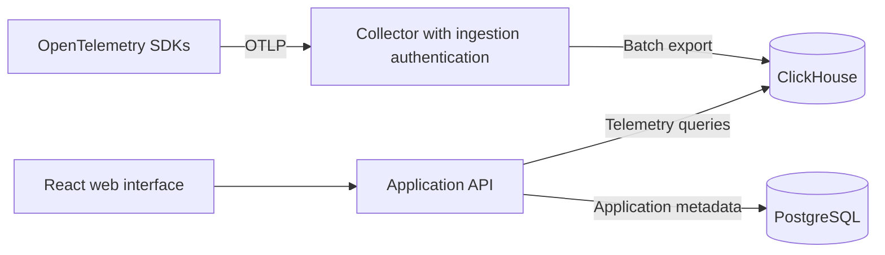

# Logice: initial stack plan

## Goal

Select a small initial stack for a Logfire-like observability platform built on ClickHouse.

## Context

- The repository is a TypeScript template with Biome, Vitest, and a TypeScript build.
- There is no observability application yet.
- Confirmed initial target: self-hosted, with one organization per deployment.
- Confirmed database responsibilities: ClickHouse stores telemetry; PostgreSQL stores application data only.
- Confirmed application languages and framework: Go backend and React with TypeScript frontend.
- Confirmed authentication methods: account and password, passkeys, OTP, and basic OIDC with Pocket ID compatibility.
- Confirmed UI toolkit: Radix Primitives, Radix Colors, Radix Themes, and Radix Icons. Do not use shadcn/ui; Tailwind CSS is not selected.
- Confirmed external access: Cloudflare Tunnel provides public HTTPS. Do not add Caddy for certificate management. Whether `cloudflared` runs in Compose or outside it remains undecided.
- Work remains in planning. Do not implement application or infrastructure files without explicit approval. Supporting libraries below remain proposals unless marked confirmed.

## Tech Stack

| Component | Proposed choice | Reason |
| --- | --- | --- |
| Telemetry storage | ClickHouse (confirmed) | Store and query high-volume, append-oriented telemetry. |
| Instrumentation and transport | OpenTelemetry and OTLP | Accept existing instrumentation instead of building an SDK first. |
| Collection | OpenTelemetry Collector Contrib | Receive, batch, and export telemetry to ClickHouse. Verify exporter schemas before adopting them. |
| Application API | Go (confirmed); standard-library `net/http`, `clickhouse-go/v2` proposed | Serve queries and application logic with a separately compiled backend. |
| Web interface | TypeScript and React (confirmed); Vite, TanStack Router, TanStack Query proposed | Build an interactive trace and log explorer without an SSR requirement. |
| Application metadata | PostgreSQL (confirmed); `pgx` proposed | Store users, organizations, projects, API token hashes, and settings. Do not store telemetry in PostgreSQL. |
| Local deployment | Docker Compose | Run the application, collector, and databases together. |
| Browser API contract | REST with OpenAPI (proposed) | Describe request and response types; generate TypeScript client types and verify them in CI. OTLP remains the telemetry ingestion protocol. |
| Database migrations | Goose with separate versioned SQL migrations for each database (proposed) | Track PostgreSQL and ClickHouse schema changes explicitly. Verify ClickHouse driver support and non-transactional migration behavior before adoption. |
| External HTTPS | Cloudflare Tunnel (confirmed) | Use Cloudflare-managed public HTTPS. No application-managed certificates are planned. |
| Static files | Go `net/http` (proposed) | Serve the built React frontend and application API under one origin without an additional web server. Use Vite with an API proxy for development. |
| UI components | Radix Primitives, Colors, Themes, and Icons (confirmed) | Use Themes for standard components and styling, Primitives for custom interactions, and Icons for interface icons. Use the Themes color tokens by default; use Colors directly only where needed. Assess table virtualization when representative telemetry results are available. |
| Checks | Biome, Vitest, TypeScript checks; `gofmt`, `go vet`, `go test`; Playwright for browser flows | Check each language with its native tools and add end-to-end coverage when a UI exists. |

Do not add Kafka, Redis, Kubernetes, a custom SDK, or a custom query language unless a verified requirement needs them. Without a durable ingestion queue, do not promise lossless ingestion.

## Architecture



For the self-hosted deployment, authenticate ingestion credentials and derive the project identity from trusted configuration or server-side lookup. Do not trust a client-supplied project attribute. Enforce project access in the query API. One organization per deployment does not remove the need for authentication. The exact authentication component is not selected yet.

## Repository Structure (Proposed)

Use one repository, one Go module at the root, and one frontend package in `web/`. No monorepo build framework is needed.

```text
logice/
├── cmd/logice/main.go          # Go application entry point
├── internal/
│   ├── httpapi/                # Routes, middleware, handlers, and static frontend serving
│   ├── auth/                   # Password, session, passkey, TOTP, and OIDC logic
│   ├── projects/               # Project management and ingestion credential logic
│   ├── postgres/               # Application-data queries and persistence
│   └── clickhouse/             # Telemetry queries and result mapping
├── web/
│   ├── src/
│   │   ├── app/                # Router, providers, and application shell
│   │   ├── features/
│   │   │   ├── auth/
│   │   │   ├── explorer/       # Trace/log tree, time selection, and duration bars
│   │   │   └── settings/
│   │   ├── components/        # Shared UI components
│   │   └── lib/               # Shared API client and small utilities
│   ├── public/
│   ├── e2e/                   # Playwright browser flows
│   ├── package.json
│   ├── package-lock.json
│   ├── biome.json
│   ├── playwright.config.ts
│   └── vite.config.ts
├── api/openapi.yaml           # Application API contract, not OTLP
├── migrations/
│   ├── postgres/
│   └── clickhouse/
├── deploy/otel-collector.yaml
├── tests/integration/         # Database and ingestion tests
├── docs/plans/
├── compose.yaml
├── Dockerfile                 # Planned multi-stage frontend and Go build
├── .env.example               # Variable names and non-secret examples only
├── go.mod
└── README.md
```

- Create directories only when they contain required code or configuration; this tree is not an instruction to create empty scaffolding.
- Keep Go unit tests beside the code as `*_test.go`; keep frontend unit tests beside their components or feature logic.
- Keep explorer-specific UI inside `features/explorer/`, not in shared components. Avoid generic service/repository layers until they solve a demonstrated problem.
- Keep Collector configuration under `deploy/`. Add tunnel configuration only if Logice will manage `cloudflared`; never commit tunnel credentials.
- Keep Playwright tests, configuration, and dependencies in `web/`. Keep cross-component database and ingestion tests in `tests/integration/`.
- `cmd/logice` creates database clients, connects application components, and starts HTTP serving. Database packages must not import `httpapi`. Define small persistence interfaces in the consuming feature package only when needed; database implementations must not depend on concrete feature services. Do not add a generic repository framework.
- Define OpenAPI generation commands before adding generated code. Keep generated outputs separate from handwritten code and verify generated clients in CI.

### Build and Asset Packaging (Proposed)

- Use filesystem assets initially, not `go:embed`. Build the frontend in a Node.js Docker stage using the manifest and lockfile in `web/`; build the Go executable in a separate Go stage.
- Copy the Go executable and `web/dist/` into the runtime image. Run from `/app` and serve the frontend from `/app/web/dist/`. Verify that the built image serves `index.html` and its referenced assets, and that missing API routes do not return the SPA HTML fallback.
- Copy versioned SQL into `/app/migrations/postgres/` and `/app/migrations/clickhouse/` for the selected migration runner. Do not embed migrations initially. Specify the runner and its deployment command after verifying Goose support for both databases.
- Development uses Vite with an API proxy. Go unit tests and builds must not require an existing frontend build.
- If embedding is selected later, place assets or SQL below the embedding package. Go embed patterns cannot reference parent directories with `..`.

### Template Tooling Migration (Planned)

- Replace the template `src/` and `tests/index.test.ts` when implementation is approved. Move the frontend manifest, lockfile, TypeScript configuration, and Biome configuration into `web/`; update their relative paths. Do not retain a root npm manifest or lockfile without a demonstrated need.
- Keep Git hooks and shared scripts at the repository root. Update Husky setup to work when dependencies are installed in `web/`, and make hook commands use the correct working directory and `web/node_modules` executables. Remove automatic Biome configuration migration and unrelated file rewrites from the pre-commit check.
- Replace the existing CI install-only job with explicit Go formatting, vet, and test checks, plus frontend install, Biome, TypeScript, unit-test, and build checks. Set the npm cache dependency path to `web/package-lock.json`.
- Run Playwright from `web/` against the application and run database/ingestion integration tests with their required services. Verify the runtime image build and frontend asset serving separately from unit tests.
- Remove the template npm publishing workflow, Changesets configuration, and npm release scripts. Define application image and Go binary releases separately when a release target is selected; do not publish Logice as the template npm package.
- Update README commands and dependency-update configuration for the root Go module and `web/` npm package. Verify installation and checks from a clean checkout, including hook setup.

## UI Reference

The user supplied this reference during stack planning: https://sharex.narumi.dev/2026/10/18/snqDm641jrlzck6R.png. Treat it as a design reference, not approval to implement every visible control.

The image shows a combined trace/log explorer with a time histogram and range selection, expandable parent/child rows, timestamps and service labels, duration bars, SQL search, and a Live control.

Proposed supporting choices:

- Use TanStack Virtual for the flattened list of currently visible tree rows. Keep parent/child identity and expansion state separate from row positions. TanStack Table is optional if its column model is needed.
- Render bounded histogram buckets and visible-row duration bars with SVG or CSS. Do not require a general chart library for the initial explorer.
- Use the same time-to-position mapping for bars within a displayed trace. Define overview and per-trace timeline behavior explicitly before implementation.
- Use Radix components for menus, dialogs, tooltips, toggles, and layout; build the telemetry-specific tree and timeline in React.
- Use TanStack Query for fetching. Start live mode with polling unless latency and load requirements justify SSE or WebSockets.
- Add CodeMirror 6 only if a SQL editor is selected. A SQL input does not imply permission to run unrestricted SQL; define query scope, read-only access, timeouts, and result limits separately.
- Validate tree expansion, scrolling stability, and time alignment against representative nested traces before finalizing the table design.

## Authentication

### Confirmed requirements

- Support account-and-password login.
- Support passkeys through WebAuthn.
- Support authenticator-app TOTP as a second factor, confirmed by the user. Email codes are not in scope.
- Support OIDC login, with Pocket ID as a required compatibility target.
- Store authentication data in PostgreSQL, not ClickHouse.

### Proposed design

- Keep authentication in the Go backend; do not require an additional identity service for local login.
- Hash passwords with Argon2id using `golang.org/x/crypto/argon2`.
- Use `go-webauthn/webauthn` for passkey registration and authentication.
- Use `coreos/go-oidc/v3/oidc` and `golang.org/x/oauth2` for OIDC discovery, token validation, and Authorization Code flow with PKCE, state, and nonce checks.
- Identify external accounts by issuer and subject. Do not automatically link accounts by matching email addresses.
- Use opaque browser sessions backed by PostgreSQL. Use HttpOnly, Secure cookies in HTTPS deployments, an explicit SameSite policy, and CSRF protection for state-changing requests. Rotate sessions after authentication and revoke them on logout.
- Separate user sessions from project ingestion credentials.
- Define a stable external URL before passkey enrollment. Verify WebAuthn origin and RP ID; require HTTPS except for supported localhost development.
- Use a maintained TOTP library; `pquerna/otp` is a candidate pending version and maintenance review.
- Define administrator bootstrap, enrollment verification, login throttling, recovery codes, and account recovery before implementation. Encrypt TOTP shared secrets with a key stored outside the database and reject reuse within a time step.
- Proposed TOTP enrollment: require recent authentication, generate a pending secret, and enable the factor only after a valid code is verified. Provide single-use recovery codes and store only their hashes.
- Define second-factor policy for each login method. Whether passkey and OIDC logins require local TOTP remains undecided.
- Verify library versions and maintenance status before adoption.

### Acceptance criteria

- Test password login, failed login, throttling, logout, session expiry, and CSRF protection.
- Test passkey registration and authentication, including wrong-origin and challenge-reuse rejection.
- Test password-plus-TOTP login, enrollment verification, invalid and out-of-window codes, code-reuse rejection, throttling, single-use recovery codes, and factor removal or reset.
- Test OIDC against Pocket ID for login, rejected state/nonce/issuer/audience, and safe account linking. Do not claim compatibility until this test passes.

## Assumptions

- Proposed first slice: ingest traces and logs, search them, and display a trace waterfall.
- Metrics, alerts, dashboards, billing, and LLM-specific views are not selected for the first slice.
- Start with one Go application backend rather than separate application microservices.
- Node.js is needed for frontend tooling, not as an application backend.
- Keep OTLP reception and batching in the Collector initially; do not duplicate them in Go without a verified need.

## Unknowns

- Should local TOTP apply only to password login, or also to passkey and OIDC login?
- What are the required administrator bootstrap, enrollment, and recovery flows?
- What stable public hostname will Cloudflare Tunnel expose, and will `cloudflared` run in Compose or outside it?
- How will telemetry reach the Collector? Prefer OTLP/HTTP for ordinary public Tunnel access; verify Tunnel support before claiming direct public OTLP/gRPC compatibility.
- Restrict direct origin access, trust forwarded headers only from the tunnel proxy, and configure the external URL explicitly for secure cookies, WebAuthn origins/RP ID, and OIDC redirects. These checks remain required even when TLS terminates at Cloudflare.
- What backup and restore process covers PostgreSQL, ClickHouse, and the separate TOTP encryption key?
- What event rate, retention period, and deployment budget must the first version support?
- Which Logfire workflows are essential for the first version?

## Plan

- [x] Select the deployment target and record explicit user acceptance here. The user selected self-hosted, with one organization per deployment.
- [ ] Define the first user workflow and expected load, with measurable acceptance criteria.
- [ ] Confirm or replace each proposed stack component and record the reasons.
- [ ] Specify package ownership and test locations using the proposed repository structure; verify that frontend tests use `web/` dependencies and Go package dependencies have no import cycles.
- [ ] Validate the proposed image and migration packaging with a build design that names asset paths, migration commands, and frontend-serving smoke tests.
- [ ] Define the template-tooling migration with clean-checkout install commands, explicit Go/frontend CI checks, hook setup, and removal of npm publishing.
- [ ] Test Collector-to-ClickHouse ingestion with sample traces and logs; verify attribute preservation and trace lookup.
- [ ] Specify user authentication and recovery flows; verify the design against the authentication acceptance criteria above.
- [ ] Specify ingestion authentication, project isolation, retention, and retry behavior for the selected target.
- [ ] Draft the implementation sequence with tests for ingestion, querying, and the first browser workflow.

## Completion Checklist

- [ ] The user accepts the initial target and stack.
- [ ] A sample telemetry fixture can be ingested and queried through the proposed data path.
- [ ] Required authentication and isolation checks are defined.
- [ ] The implementation plan specifies test ownership, runtime asset and migration paths, and clean-checkout tooling checks.
- [ ] An implementation plan has finite acceptance checks for the first usable release.
