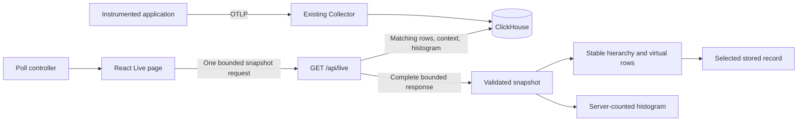

# Real-data Live page implementation plan

## Goal

Implement `/live` as a real-data trace and log explorer. Use the existing preview's layout and interactions, but read telemetry from ClickHouse through a bounded Go API. Deliver a unified hierarchy, server-side histogram, automatic refresh, filters, stable scrolling, and an inspector, with real-service and browser evidence.

Completion means a usable **local, single-project** Live page. It does not mean production authentication, public deployment, durable streaming, or visibility of spans before they are exported. This document plans implementation; it does not record completed implementation or approve outstanding deployment policies.

## Context

Inspected base: `main` at `a6e4b98` on 2026-10-23. The working tree was clean. No repository or ancestor `AGENTS.md` was present.

| Existing path | Verified behavior and constraint |
| --- | --- |
| `web/src/main.tsx`, `web/src/app.tsx` | `/preview` has a separate entry point. Trace/log pages use one-shot requests and full-navigation refresh. |
| `web/src/preview/` | Simulated hierarchy, expansion, filters, timeline, histogram, follow mode, and inspector. Simulation IDs, millisecond timestamps, and running spans are not a real-data contract. |
| `web/src/api.ts`, `web/src/telemetry.ts` | Existing request helpers, trace/log DTOs, nanosecond parsing, and duration formatting can support the new page. Logs have no durable record ID. |
| `internal/httpapi/` | Strict filter parsing, JSON errors, request cancellation, and independent liveness. Existing query handlers have a five-second deadline. |
| `internal/telemetry/` | Parameterized project/time filters, read-only queries, four database connections, and resource limits. Existing lists and detail routes cannot supply a unified feed or histogram. |
| `tests/integration/`, `web/e2e/`, `scripts/validate-compose-web.sh` | Disposable real-service ingestion/query tests and built-image browser checks already exist. |
| `tests/fixtures/web-layout/web/package.json` | TanStack Virtual 3.14.21 is tested only in an isolated fixture. The application has React but does not yet have this dependency. |

Design and behavior references: [live explorer preview](../design/live-explorer.md), [current local API](../local-telemetry.md), [exporter compatibility](../telemetry-compatibility.md), and [validation procedures](../validation.md).

## Scope and non-goals

In scope:

- A new real-data `/live` route and navigation entry; keep `/preview` clearly marked as simulated.
- Completed exported spans, correlated logs, uncorrelated logs, partial hierarchies, filtering, histogram selection, polling, and inspection.
- Bounded backend work, bounded browser state, virtualization, cancellation, failure recovery, and compatibility checks.
- Tests, user documentation, validation evidence, and safe local update instructions.

Not in scope:

- SSE, WebSockets, an ingestion cursor, an append-only replay stream, or a durable queue.
- Authentication implementation, dynamic projects, public Tunnel access, database role changes, or production migrations.
- An application-wide Router/Query migration, a general component framework, a SQL editor, or new deployment options.
- Span events/links as separate feed rows, metrics, alerts, dashboards, or lossless reconstruction of original OTLP attributes.
- Replacing the existing trace/log APIs, their search semantics, or their documented limits.

The existing local security boundary remains mandatory: fixed trusted project `validation`, loopback access, and no public exposure. This plan does not resolve or remove the initial stack plan's separate acceptance condition.

## Architecture



Use **full-window snapshot polling**, not timestamp-based incremental append. Each successful response replaces the committed snapshot. This avoids an invented ingestion watermark and discovers late exports whose event timestamps are earlier than the last poll. Records outside the selected window or row limits can still be absent; do not promise complete delivery.

The reads share one time window and deadline, but ClickHouse reads across two tables are not a transaction. Data can become visible between component queries. Return the resolved window and query time; do not label the response a transactionally consistent snapshot.

### Ownership

| Planned path | Main responsibility |
| --- | --- |
| `internal/telemetry/live.go`, `live_query.go` and colocated tests | Live DTOs, bounded store operation, identity/grouping, and parameterized SQL. Keep database code independent of HTTP. |
| `internal/httpapi/live.go` and colocated tests | Live query parsing, admission limit, HTTP contract, cancellation, response-size check, and sanitized errors. Integrate with existing routing. |
| `web/src/live/api.ts` and tests | Live request encoding, bounded response reading, and runtime DTO validation. Reuse common error/time helpers where compatible. |
| `web/src/live/model.ts` and tests | Record identity, hierarchy, visible-row flattening, time mapping, and snapshot reconciliation. No timers or DOM access. |
| `web/src/live/use-live.ts` and tests | One polling lifecycle and request generation ownership. Keep the scheduler testable with fake timers/fetch. |
| `web/src/live/page.tsx`, `tree.tsx`, `inspector.tsx`, `live.css` | Route composition, virtualized interaction, and real-record presentation. Split further only for a demonstrated responsibility. |
| `web/e2e/live.spec.ts`, `tests/integration/live_test.go` | Browser behavior and real Collector/ClickHouse/API compatibility. |

Keep simulation-specific code inside `web/src/preview/`. Reuse proven pure helpers and presentation only when this does not make the real page depend on a sample session. Do not refactor the whole application shell to add one route.

## User-visible contract

### Route, filters, and time

- `/live` starts with a five-minute rolling window and Live enabled. Offer one-, five-, and fifteen-minute windows.
- Use the server clock to resolve rolling windows. Preserve UTC RFC3339Nano timestamps and `[from, to)` boundaries.
- Pause aborts active work, invalidates its generation, stops timers, and freezes the last committed response and its absolute window. Pausing before the first response shows **Paused before first result**, with no invented server window and no background request.
- Paused Refresh performs exactly one request for the frozen window. Before any successful response, it resolves the selected rolling window once and then pins the returned bounds. Resume performs one immediate rolling-window request, then resumes scheduling. Hidden/offline time is not replayed.
- Store applied filters and mode in the URL. Live URLs store `range`; paused URLs store exact `from`/`to` once available. Before the first result, `mode=paused&range=5m` represents the paused unresolved range without triggering a fetch. `mode` is a page parameter, not an API parameter. Use `replaceState` for polling, not one history entry per update. Reload/back/forward must restore the represented mode and filters.
- Offer exact service name, literal text, Errors only, and minimum log severity. Apply edited filters together on submission; do not query on every keystroke.
  - Text is a case-insensitive literal substring of span name/log body or trace/span ID. Do not search attributes or execute SQL.
  - Errors only means matching spans with `StatusCode = 'Error'` and matching logs with severity at least 17. Minimum severity applies only to logs; combine it with Errors only using the higher threshold.
  - A retained nonmatching ancestor is marked **Context**, not counted as a match.
  - These rules are specific to `/live`; existing list search and Errors only behavior remain unchanged.
- Selecting a histogram interval pauses Live and applies fixed bounds. Provide keyboard-accessible bucket selection and explicit time inputs; pointer drag must not be the only input method.
  - Expand a selection narrower than one second to a one-second interval centered on its midpoint, shifting it inside the displayed bounds when necessary. In a one-second window, any bucket selection retains that whole window. Show the minimum-width hint; repeated zoom must never submit a shorter API interval. Explicit time inputs reject subsecond intervals with an inline error.
- Trace-detail links retain the displayed absolute bounds. Do not replace the current page or its selection merely to inspect a record.

### Tree and inspector

- Display matching spans and logs in one hierarchy. Attach a span to its parent only within the same trace. Attach a log only to its recorded trace/span pair.
- Keep missing-parent spans, logs without a retained span, uncorrelated logs, invalid identifiers, and multiple roots visible with accurate labels. Never invent a recorded parent or complete trace.
- Break cycles deterministically, reject self-parent edges, and bound indentation without dropping deeply nested records. Preserve the recorded IDs in the inspector.
- Sort root groups and siblings by event time, then stable identity. Late parents can reparent children without changing selection or expansion identity.
- Preserve expansion, selection, inspector tab, keyboard focus, and the first visible row's pixel offset across refreshes. Auto-expand affects new ancestors only; Collapse all turns it off. Applied filters can force matching paths open without overwriting manual expansion state.
- Follow latest scrolls to the newest retained group. Scrolling away disables follow. A counter reports newly visible logical records relative to the previous snapshot, not guaranteed ingested-event totals. Repeated snapshots do not increment it.
- When the scroll anchor leaves the bounded snapshot, use the nearest retained neighbor and show a window/limit notice rather than a silent jump. Retain at most one selected record outside the snapshot, marked **Outside current results**.
- Show timestamps, severity/status, service, IDs, duration, resource/record attributes, and available scope metadata. Label JSON as **Stored record JSON**, not original OTLP. Preserve exporter string-conversion limitations.
- Treat `Unset`, `Ok`, and `Error` as different span statuses. Do not infer **Running**, completion, progress, or increasing duration from missing parents, unset status, or recent timestamps. Standard SDK span export normally occurs after span completion.
- Use a common duration scale across retained trace groups. Each trace offset starts at its earliest retained event; label partial context. Use BigInt nanoseconds before converting bounded display ratios. Logs are markers, not duration bars. Keep histogram time mapping separate from per-trace timing.
- Escape closes the inspector and restores focus to the selected row, or the feed when that row is gone. On narrow screens, provide dialog focus containment and a noninteractive background. Support reduced motion and visible focus.

## API and bounded query contract

Add `GET /api/live`. Do not fetch one trace-detail route for every visible trace.

### Request

Accept exactly one of:

- `range=1m|5m|15m`, defaulting to `5m` when no time parameters exist; or
- paired `from` and `to` RFC3339Nano bounds, with an interval from one second through fifteen minutes.

Other allowed parameters: `service`, `search`, `errorsOnly`, `minSeverity`. Retain the existing 200-byte service/search bounds and severity range 0–24. Reject malformed encoding, duplicate/unknown parameters, mixed time modes, unsupported ranges, and invalid nanosecond bounds with HTTP 400. Validate Live bounds again at the storage boundary; do not change the existing 24-hour `Filter` contract. Do not accept project overrides, SQL, client-defined row caps, or cursors.

### Response

Define and fixture-test the DTO before implementing the UI:

- Resolved `window`, `queriedAt`, and applied filters.
- Matching span/log rows with stable IDs, occurrence counts, and conflict metadata; separate context spans and their role.
- Exactly 60 histogram buckets with explicit inclusive start/exclusive end bounds and span/log/error counts. Return large counts as decimal strings.
- Separate `spansTruncated`, `logsTruncated`, `contextTruncated`, and `traceGroupsTruncated` indicators and effective limits.
- State that trace completeness is unknown even when no limit was reached. Do not expose database exceptions, SQL, credentials, or query plans.

Histogram counts cover all matching **stored rows** in the selected window, before feed caps and excluding context-only rows. Duplicate stored rows contribute to these counts. Distinguish these physical counts from grouped feed rows and retained-row statistics. Use identical predicates for matching rows and histogram counts; return 60 zero-filled buckets for empty data. Compute bucket boundaries with integer nanoseconds.

Send JSON errors and `Cache-Control: no-store`. Keep `/api/healthz` independent of storage. Return no partial success body when a component read fails. First-ingestion missing tables can be empty only for the driver's structured UNKNOWN_TABLE condition, not arbitrary SQL/authentication errors.

### Identity and duplicate policy

There is no stored ingestion sequence or durable log ID. Resolve this before building UI state:

- Span identity is the trusted project plus normalized `(traceId, spanId)` when valid.
  - Group repeated identical stored payloads and report occurrence counts.
  - Evaluate conflicts across all stored variants of that identity within the trusted project/window, before matching filters or LIMIT. A group matches if any variant matches; choose the canonical minimum matching payload as its displayed representative. Report total stored occurrences separately from histogram matching-row counts. Context-only groups use their canonical minimum payload.
  - If variants conflict, return a conflict flag; do not call the representative the latest version. If recorded parent IDs differ, detach the node and mark **Ambiguous parent** rather than selecting an unproved parent edge. Preserve both warnings in the inspector.
  - Malformed IDs use a namespaced content identity and remain non-linkable; never attach them by a partial ID match.
- Log identity is a namespaced SHA-256 fingerprint of a versioned canonical stored payload. Include timestamp, IDs, severity, body, service, attributes, scope, trace flags, schema URLs, and every other stored field that can distinguish log records. The current reduced `Log` DTO alone is insufficient.
  - Canonicalize attribute key/value ordering without losing distinctions. Test reordered map entries and delimiter-like text. Group by canonical content, not the digest alone; detect unequal canonical payloads with the same generated identity and fail with a sanitized error rather than merging them.
  - Aggregate byte-identical stored content with an occurrence count. Identical independent emissions and exporter retries cannot be distinguished; label this as identical content, not proven transport duplication.
- Perform grouping before LIMIT. Never derive IDs from row index, current time, arrival order, or only timestamp/body. Verify deterministic selection across repeated reads and insertion order.
- Do not sum occurrence counts across polls. A successful full response is the current result, not an incremental update.

### Initial engineering bounds

These are implementation/test bounds for this local page, not accepted production capacity targets. Use code constants, not new environment variables or feature flags.

| Area | Bound |
| --- | --- |
| Window | 1, 5, or 15 minutes live; fixed interval from one second through 15 minutes |
| Matching feed | At most 500 grouped spans and 500 grouped logs; newest first for selection, stable identity tie-break |
| Trace context | At most 100 retained valid trace IDs and 500 additional context spans; include a limit sentinel and explicit flags |
| Browser records | At most 1,500 committed records plus one selected-record copy; no unbounded history or ID set |
| Histogram | Exactly 60 buckets, independent of feed truncation |
| Backend | One five-second request budget shared by all component reads; retain existing per-query read-only, memory, and result settings |
| Admission | At most two active Live requests per API process; excess requests return 429 with `Retry-After: 2`, without starting database work |
| Payload | At most 4 MiB encoded JSON; HTTP 422 `response_too_large` if exceeded, without silently clipping record content |
| Browser request | Eight-second timeout and a 4 MiB streaming-read cap; validate structure, record counts, IDs, times, and count encodings before commit |
| Polling | One request at a time; next request two seconds after success, not every two seconds regardless of request duration |
| Retry | Retry transient failures after 2, 4, 8, 16, then at most 30 seconds; clamp valid Retry-After to 2–30 seconds |
| Render | Virtualized fixed-height feed rows; at most 120 mounted event rows at desktop/mobile test viewports |

For trace-context selection, retain the newest 100 valid trace groups represented by matching span and log candidates, ordered by latest matching timestamp and trace ID. Uncorrelated logs do not consume trace-group slots. Remove matching records from excess trace groups and set `traceGroupsTruncated`. Retrieve context in a single bounded query for those IDs, always with the same trusted project and time bounds, without service/text/error predicates. Rank each trace's context candidates by direct referenced parent first, then earlier event time and stable identity. Allocate the 500 slots round-robin by that per-trace rank, with deterministic trace-group ties; one wide trace must not starve every other trace. Deduplicate against matching rows and retain only available ancestor paths in the displayed tree. Missing context remains explicit; do not issue recursive queries or fetch outside the window.

Use a small fixed set of sequential parameterized queries for matching spans, matching logs, context, and the two histogram aggregations. All share the same cancellation/deadline. LIMIT does not bound grouping cost: real-service tests must verify memory/time-limit behavior. On overload or insufficient query budget, fail visibly rather than dropping filters, skipping a histogram, or expanding limits.

### Polling and failure lifecycle

Use an explicit state model: initial loading, live, paused, suspended, retrying/stale, empty, invalid query, and unavailable.

- Abort and invalidate active work on pause, filter/time change, navigation, unmount, hidden tab, and offline transition. Remove every timer/listener on cleanup; test React StrictMode setup/cleanup cycles.
- Hidden/offline suspends a requested Live mode without rewriting it as paused. Return to a visible/online page causes at most one immediate refresh. Coalesce repeated resume events.
- Compare generation tokens before committing any response or scheduling from a completion/finally handler, including responses whose mock/network ignores abort. Old work must not overwrite new filters or restart a stopped scheduler.
- Network errors, timeout, 429, and 503 retain the last successful snapshot with a stale label, last-success time, retry status, and manual retry. Never show stale data as a fresh empty result.
- HTTP 400 and 422 stop automatic retries until the query changes or an explicit retry occurs. Invalid JSON/schema and an unsupported endpoint also stop automatic retries and show explicit errors, never simulated fallback data.
- If a future authentication boundary returns 401/403, stop polling and clear retained telemetry/selection. Test this behavior without claiming authentication is implemented.
- First load failures have no stale snapshot. A healthy empty response is a normal state. Recovery replaces stale data atomically and resets backoff.

## Tech stack

Keep Go `net/http`, `clickhouse-go/v2`, React, TypeScript, the current CSS approach, Vitest, and Playwright. Add only `@tanstack/react-virtual` for hierarchy-aware row virtualization. Review and pin an application-compatible version at implementation time; 3.14.21 is the existing fixture candidate, not a dependency already installed in the application. Scan the actual updated lockfile.

Do not add TanStack Query/Router solely for this page. A single testable polling owner is sufficient. Do not expand this work into OpenAPI generation for all existing routes; use explicit Live DTOs, runtime validation, and shared contract fixtures. Keep all new frontend dependencies in `web/`.

## Execution evidence

Execution branch: `narumi/feat/live-page` from `origin/main` at `a6e4b98`. The subsequent user request authorizes this plan's implementation and PR delivery. The existing local service project and credentials remain unchanged.

- Native `TestLive*` passed in 68.511 seconds with Go 1.26.10 and ClickHouse 26.8.30.8, including canonical identity, full stored fields, epoch-zero ranking, case-normalized IDs, all five effective query settings, actual cancellation, memory-limit failure, context/caps, and outage recovery. Evidence: `/tmp/logice-live-backend-final-VaNrPq.log`.
- Exact encoded-size preflight rejects oversized escaped content before allocation; the 8 MiB input regression measured six allocations/504 bytes. The pinned driver's deadline override is handled only for Live DB calls while preserving shared cancellation.
- Frontend Biome, TypeScript, build, audit, and 192 unit tests pass. A 15-minute virtual-time test rotates 450 maximum-size snapshots with one physical request, one at-rest poll timer, and zero timers after stop.
- After the initial 29/32 and 35/36 browser failures were fixed, the third complete browser run passed all 36 tests in 28.8 seconds, including real post-open ingestion, all DOM limits, focused-orphan reparenting, and the original anchor tolerance. All failed runs are retained. Final review's malformed-span client eligibility mismatch has an additional passing regression test; the final built-image rerun is pending.
- The complete real-service regression suite passed in 180.080 seconds; its local 30-sample p95 was 162.629 ms. Retained evidence and external handoff are in `docs/validation.md` and `docs/live-telemetry.md`. Clean-committed-checkout and final delivery checks remain open.

## Plan

All tasks below are agent-executable implementation work. Complete them in order; do not mark a task complete until its evidence passes.

- [x] **1. Prove identity and query feasibility.** Inventory the pinned stored columns and build disposable fixtures for repeated/conflicting span IDs, identical logs, scope-only differences, reordered attributes, malformed IDs, and nanosecond ties. Prove grouping-before-limit, canonical identity, bounded context selection, histogram boundaries, and the five-second shared budget against real ClickHouse. Record exact version/SQL evidence. If these rules cannot hold without a schema change, block dependent tasks and report the scope change; do not substitute unstable IDs.
- [x] **2. Define the Live contract.** Add Go DTOs, strict request parsing, sanitized error codes, and valid/invalid JSON fixtures for the response defined above. Specify all truncation flags and count meanings. Acceptance: parser/handler tests reject malformed, duplicate, unknown, mixed-mode, oversized, and project-override inputs; an empty-response fixture has exactly 60 zero-filled buckets; existing API contract tests still pass.
- [x] **3. Implement the bounded store operation.** Add parameterized matching/context/histogram queries, identity grouping, deterministic ordering, cancellation, and structured missing-table handling. Acceptance: real-service fixtures verify trusted scope on every query, exact boundaries, no N+1 calls, counts before caps, context flags, and duplicate/conflict behavior.
- [x] **4. Expose `/api/live` safely.** Connect the reader and route; add two-request admission control, a shared five-second deadline, no-store headers, response-byte enforcement, and all-or-error serialization. Acceptance: handler tests cover GET/method errors, no reader, overload/release after cancellation, large responses, component failure, and independent liveness. Unknown API routes must still return JSON, not SPA HTML.
- [x] **5. Build the client and polling owner.** Implement URL/time modes, capped response decoding, generation guards, completion-based scheduling, pause/resume, hidden/offline suspension, backoff, and stale-state recovery. Acceptance: fake-timer/fetch tests cover hung requests, ignored abort, rapid mode/filter changes, every retry class, bounded bytes, malformed payloads, StrictMode-style cleanup, and zero active timers/requests after stop.
- [x] **6. Build the real-data hierarchy model.** Normalize the validated DTO without losing IDs or nanoseconds; reconcile full snapshots; preserve identity, contextual ancestry, conflicts, expansion, selection, and new-visible counts. Acceptance: pure tests cover orphan/log-only traces, later parents, cycles, self-links, multiple roots, extreme depth/width, map ordering, timestamp ties, repeated snapshots, eviction, and no fabricated running durations.
- [x] **7. Implement `/live` and virtualization.** Reproduce the preview's usable layout with real data, filter/time controls, server histogram, context/truncation/stale notices, virtual tree, timing bars, inspector, and trace links. Add navigation without removing `/preview`, `/traces`, or `/logs`. Acceptance: component/model tests plus Chromium prove keyboard tree navigation, offscreen focus, narrow-screen inspector focus containment, URL reload/back/forward, interval selection including repeated zoom and minimum-width keyboard selection, reduced motion, empty/error states, and at most 120 mounted event rows.
- [x] **8. Preserve scroll and interaction state under updates.** Implement stable-key anchoring, follow mode, bounded new-visible notifications, anchor eviction fallback, and retained selection. Acceptance: browser tests assert less than 3 CSS pixels of anchor drift while the anchor survives, stable selection/tab/focus after late-parent insertion, no forced scrolling when follow is off, and explicit behavior when limits evict the anchor.
- [x] **9. Add real-ingestion Live browser workflows.** Send identifiable completed spans and correlated/uncorrelated logs through the disposable Collector after `/live` opens. Verify automatic appearance, paused absence, resume, late arrival, filtering/context, conflict/identical-content labels, histogram values, and stored-record inspection. Acceptance: storage confirmation has a 30-second limit, followed by a 20-second limit for automatic page visibility while Live is active; `/preview` still makes no telemetry requests and all existing list/detail workflows pass. Do not infer running-span support from simulated tests.
- [x] **10. Validate fault, limit, and rendering cases.** Use disposable services for ClickHouse outage/recovery, one missing table, timeout/cancellation, row/context/group caps, other-project data, and oversized records. Use controlled browser responses for 401/403, invalid JSON, delayed stale responses, and offline/hidden transitions. Acceptance: no stale overwrite, secret-bearing error, leaked request/timer/admission slot, false empty state, or silent truncation occurs.
- [x] **11. Measure bounded performance.** Seed a deterministic disposable 10,000-record fixture: 5,000 spans and 5,000 logs, including a 1,000-deep chain, wide traces, 200 trace groups, and uncorrelated logs. Record hardware, versions, payload sizes, and timing method. Run 30 sequential snapshots after warm-up; target API p95 at most two seconds on the recorded host, with no request exceeding the five-second server budget. Acceptance: limits/flags are correct, maximum-size fixtures retain at most 1,500 records and 120 mounted rows, and a browser run covering 15 minutes of simulated time with rotating capped snapshots keeps record/ID state within its limits, with at most one active request and one scheduled poll timer. This is a bounded-state check, not a measured production heap-leak claim. Report this as a local engineering result, not production capacity. A missed target remains open; do not silently raise it.
- [ ] **12. Integrate tests and documentation.** Add focused suites to the existing integration/browser jobs and keep their service waits and cleanup bounded. Update README, local telemetry usage, live design notes, and dated validation evidence with the actual route, semantics, limits, identity caveats, reproduction commands, screenshots, and unsupported paths. Acceptance: all repository checks below pass; inspect desktop/mobile captures under ignored artifacts; verify no operator service/data changed and no disposable resource remains.
- [ ] **13. Review the complete change and prepare delivery.** Review correctness, security, lifecycle safety, compatibility, regressions, dependency changes, and scope. Verify a clean committed checkout, record exact revisions and hosted CI when available, and prepare a concise PR summary with evidence and remaining release restrictions. Acceptance: review findings are resolved, intended paths only are staged, no secrets/binaries are committed, and no package/tag/release workflow is published or dispatched. The subsequent execution request authorizes commits, a push, and a pull request; it does not authorize production deployment or releases.

### Required validation commands

Use Go 1.26.10 or a patched compatible later toolchain and the repository's pinned Node/npm versions. Run focused tests first, then the complete existing gates. These commands are implementation acceptance checks, not checks claimed passed by writing this plan.

```sh
export GOTOOLCHAIN=go1.26.10

go test -count=1 ./internal/httpapi/... ./internal/telemetry/...
go test -race -count=1 -timeout=2m ./internal/...
# Name the new integration cases TestLive* so they can run independently.
go test -tags=integration -run '^TestLive' -count=1 -timeout=5m -v ./tests/integration/...
npm --prefix web ci
npm --prefix web test

go mod verify
sh scripts/check-go.sh
timeout --kill-after=5s 240 go run golang.org/x/vuln/cmd/govulncheck@v1.9.0 -test -tags=integration ./...
npm --prefix web run ci
npm --prefix web audit --audit-level=low
./scripts/validate-web-layout.sh
sh scripts/validate-checks.sh
npm --prefix web exec -- playwright install --with-deps chromium
timeout --kill-after=60s 420 sh scripts/validate-compose-web.sh
timeout --kill-after=5s 540 go test -tags=integration -count=1 -timeout=8m -v ./tests/integration/...
uv run --project examples/python --locked python -m unittest discover -s examples/python -v
actionlint .github/workflows/ci.yml
sh -n scripts/*.sh .husky/pre-commit
git diff --check
```

Collect screenshots, browser traces, performance measurements, and sanitized failure logs in ignored test artifacts. Record their interpretation and exact commands in `docs/validation.md`; do not commit telemetry dumps or image binaries. `scripts/validate-checks.sh` tests a committed revision, so run it again after implementation is committed. Preserve the integration harness's cleanup reserve; an outer command runner must not kill it at 300 seconds. If the larger browser suite exceeds its existing work budget, split bounded jobs rather than skipping regression tests.

## Risks and disposition

| Risk | Required disposition |
| --- | --- |
| Late exports have old event timestamps | Full-window replacement finds them while retained; records outside window/caps remain unsupported, visibly documented. |
| Logs lack a durable ID | Canonical stored-content grouping plus occurrence counts; no exactly-once or duplicate-cause claim. |
| Conflicting span exports have no stored version | Deterministic representative and explicit conflict state, not last-write-wins. |
| Context and separate table reads are incomplete | Context flags, unknown completeness, per-response resolved bounds, and no transactional-snapshot claim. |
| Grouping/histograms scan more rows than LIMIT | Fixed time bounds, shared deadline, memory limits, admission control, and measured real-service tests. |
| Untrusted large records or HTML-like content | Encoded response cap, bounded streaming client, text-only rendering, and explicit oversized/error tests. |
| Tree updates move rows/focus | Stable identities, virtualization-aware anchor/focus ownership, and late-parent/eviction browser tests. |
| Local authentication is absent | Keep the existing loopback restriction; prohibit public use and client project selection. |

## Rollback / Recovery

- This implementation requires no telemetry schema migration or Collector ingestion change. Do not add an ingestion ID column or edit retained data as a shortcut for UI identity.
- To roll back, restore the previous web/API application revision and rebuild only those services in an explicitly selected local project. Keep Collector/database versions, credentials, and volumes unchanged.
- Old web versions do not call the additive endpoint. A new web version against an old API shows a clear unsupported-endpoint state; it must not substitute sample data. Rebuild compatible web/API versions together to restore service.
- Stop polling on unmount before replacing the UI. Check that in-flight query cancellation releases admission/database resources.
- Tests remove only uniquely named disposable projects and their owned resources. Never run Docker-wide prune or `down --volumes` against operator data. Existing forced-kill recovery guidance remains applicable.

## External Handoff

- **Visual review:** The user reviews density, hierarchy, inspector placement, colors, and motion using the prepared desktop/mobile captures and local `/live` route. Prerequisite: automated browser evidence and a reproducible build. Expected result: specific visual feedback. Subjective acceptance is not claimed by automated tests and is not an added coding-completion gate.
- **Production owner:** Public use requires the separately approved authentication/project-isolation, hostname/Tunnel, production roles/migrations, retention/loss budget, and recovery work. This plan neither requests secrets nor changes those decisions. Release restriction: local loopback use only; real-data Live completion does not authorize public exposure or close the initial stack acceptance gate.

## Completion Checklist

- [ ] `/live` automatically displays actual Collector-to-ClickHouse spans and logs; `/preview` remains simulated and isolated from telemetry APIs.
- [ ] Filtering, absolute/rolling time, histogram selection, hierarchy, inspector, trace links, pause/resume, and URL restoration follow the documented contract.
- [ ] Identity, identical-content counts, conflicting exports, partial context, late parents, and nanosecond timing pass deterministic real-service/model tests.
- [ ] Polling, backoff, suspension, abort, stale/error states, and cleanup pass adversarial lifecycle tests without leaks or stale overwrites.
- [ ] Every row, group, context, payload, query, browser-state, and DOM limit is enforced and visible when reached; performance evidence meets the finite targets.
- [ ] Keyboard/focus, scroll anchoring, reduced motion, narrow viewports, and existing trace/log/preview regressions pass browser checks.
- [ ] Repository and clean-checkout gates pass on the delivered revision; independent review findings are resolved and disposable resources are confirmed removed.
- [ ] Usage, validation evidence, rollback steps, known limits, and external release restrictions are retained in documentation. Only then remove this completed execution plan.
