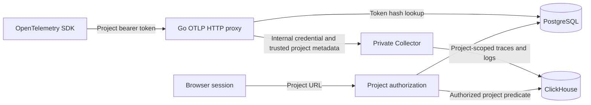

# Project Access and Ingestion Tokens

## Goal

Add isolated projects with Owner, Developer, and Viewer access. Let Owners and Developers create and revoke project-level OTLP ingestion tokens. Authorize every telemetry read against project membership and every telemetry write against its token's project.

This plan does not authorize deployment or changes to existing production data.

## Context

- `internal/auth/` provides invitation-only Passkey accounts, PostgreSQL sessions, CSRF checks, and operator recovery. The account-level `admin` flag controls registration invitations; it is not a project role.
- `internal/auth/schema.sql` contains the additive authentication schema. `Ready` in `internal/auth/store.go` currently requires schema version 1.
- `internal/telemetry/query.go` hard-codes the `validation` project. `live_query.go` and `live_store.go` also include `validation` in span identities.
- `internal/httpapi/` exposes unscoped trace, log, detail, and live routes. Authentication currently establishes an account but does not pass project authorization to telemetry reads.
- `deploy/otel-collector.yaml` and its Helm equivalent authenticate one static `OTLP_TOKEN` and overwrite resource project IDs with `validation`.
- Compose publishes Collector ports directly. Nginx currently forwards `/api` but not `/v1/traces` or `/v1/logs` to Go.
- Existing account names are display names, not unique login identifiers. Member selection must use account UUIDs.

## Access Model

| Operation | Owner | Developer | Viewer |
| --- | --- | --- | --- |
| Read project traces, logs, detail, and live data | Yes | Yes | Yes |
| List project token metadata | Yes | Yes | No |
| Create or revoke any project ingestion token | Yes | Yes | No |
| Rename the project | Yes | No | No |
| Add/remove members and change their roles | Yes | No | No |
| Transfer ownership or delete the project | Yes | No | No |

- Every active registered account can create a project and becomes its Owner.
- A project has exactly one Owner. Store ownership once, using `projects.owner_user_id`; membership rows contain only Developer or Viewer roles.
- The Owner can add an existing active account by UUID. Project membership does not register an account or issue a registration invitation.
- Ownership transfer requires an existing active member. Transfer ownership atomically and make the former Owner a Developer. Reject ordinary role changes or member removal that would remove the Owner.
- Platform administrators have no implicit project access. Preserve their existing account-registration duties.
- Project tokens are credentials for applications, not personal access tokens. They authorize writes only, never browser sessions, reads, or project administration.
- Record the token creator for audit. Removing or demoting that creator does not revoke a project token. Owners and Developers must revoke it explicitly.
- Revocation, expiry, membership removal, and project deletion are checked on each new request. Already authorized in-flight requests can finish; document this boundary.

## Architecture

### Storage and lifecycle

Use PostgreSQL for project metadata and authorization; continue to use ClickHouse for telemetry.

- `projects`: UUID, name, Owner UUID, creation time, and deletion time.
- `project_members`: project UUID, account UUID, Developer/Viewer role, creation time; unique project/account pair and foreign keys.
- `project_tokens`: UUID, project UUID, name, unique SHA-256 token hash, creator UUID, creation time, optional expiry, and revocation time.
- `project_events`: project UUID, actor UUID, action, target identifier, and timestamp. Record membership, ownership, deletion, token creation, and revocation changes without credential values.
- Generate tokens from at least 256 bits of cryptographic randomness. Return the complete token only in the successful creation response. Do not persist plaintext or provide a token-reveal endpoint.
- Token creation accepts a name and optional future expiry. Reject invalid names and expiry values. List responses contain metadata and status, never the hash or secret.
- Delete projects logically: deny reads, token management, and ingestion immediately after authorization observes deletion. Revoke their tokens in the same transaction. Retain stored telemetry until its normal TTL; do not claim immediate physical deletion.
- Serialize project authorization and metadata mutations with a consistent project-row lock. Recheck role under that lock so concurrent demotion, removal, transfer, and deletion cannot authorize a later mutation using a stale role.
- Use finite request-body and pagination limits. Start with at most 100 active projects per account and 100 non-revoked tokens per project; enforce creation limits transactionally. Do not add configuration flags for these limits.

### Browser and management API

Use explicit project URLs, not a session-wide selected-project value that can mix browser tabs.

- `GET/POST /api/projects`: list accessible projects or create a project.
- `GET/PATCH/DELETE /api/projects/{projectID}`: read metadata, rename, or logically delete.
- `GET/POST /api/projects/{projectID}/members`: list members or add an existing account by UUID.
- `PATCH/DELETE /api/projects/{projectID}/members/{userID}`: change Developer/Viewer role or remove a member.
- `POST /api/projects/{projectID}/owner`: transfer ownership to an existing active member.
- `GET/POST /api/projects/{projectID}/tokens`: list metadata or create an ingestion token.
- `POST /api/projects/{projectID}/tokens/{tokenID}/revoke`: revoke a token; repeat revocation is safe.
- `GET /api/projects/{projectID}/traces`, `/logs`, `/traces/{traceID}`, and `/live`: project-scoped telemetry reads.

Require a browser session on all management and query routes. Apply existing Origin, CSRF, JSON, and body-size checks to mutations. A bearer token cannot replace a session.

Return 404 for absent, deleted, or inaccessible projects and resources outside the selected project. Return 403 when a member lacks the required role. Avoid account-directory enumeration: Owner adds members by an exact UUID obtained outside this API, with a generic failure for unavailable accounts.

Pass an authorized project UUID through a private server-side context value to telemetry storage. Parameterize every ClickHouse project predicate, including detail logs, live context, and histogram queries. Reject reads without a trusted project scope. A URL identifies the requested project but does not prove access. Never accept a project header or resource attribute as browser authorization.

Replace legacy unscoped query routes with explicit errors after clients are migrated. Never fall back to `validation`, the first project, or all projects. Include project UUIDs in live identities in both SQL and Go.

### OTLP ingestion

- Expose `POST /v1/traces` and `POST /v1/logs` through Go and Nginx. Start with OTLP/HTTP protobuf; do not add a public gRPC proxy in this change.
- Authenticate a single bearer credential through a PostgreSQL hash lookup joined to a non-deleted project. Reject expired, revoked, unknown, or malformed tokens. Fail closed when authorization storage is unavailable. Do not cache successful token lookups in this version.
- Strip client-supplied reserved project metadata, including duplicate and case-variant headers. Set a trusted project UUID from the token record. Replace the public bearer token with a separate internal Collector credential.
- Keep OTLP parsing in Collector. Before implementation proceeds, verify metadata-to-resource propagation in the pinned Collector image using actual traces and logs. Include compressed payloads, forged resource attributes, multiple resources, duplicate headers, and absent metadata. The Collector must overwrite supplied project attributes and reject or drop unscoped input without writing it.
- Never silently restore static `validation` enrichment if metadata propagation fails. Resolve this technical gate before exposing ingestion.
- Preserve upstream OTLP status, response bodies, and partial-success responses. Do not convert a successful export into a persistence guarantee.
- Set finite proxy limits: 8 MiB encoded request body, 10-second upstream deadline, 128 concurrent ingestion requests per API instance, and 1 MiB upstream response body. Keep Collector memory, queue, retry, and decoded-message limits finite. Test limit failures and compressed input against the pinned receiver.
- Collector credentials are infrastructure secrets, never user-visible tokens. Remove normal host publication of Collector ports and public ingress paths to Collector. Restrict cluster access to the Go proxy with deployment network controls; document any CNI enforcement requirement.
- Local tests can reach Collector only through an explicit disposable test override. Existing direct-Collector gRPC transport tests do not establish project-token gRPC support.

### Web application

- Add project list/create views and a project switcher. An account with no projects sees a create-project action, not legacy shared data.
- Put project UUIDs in navigation, filters, copied links, and live routes. Clear old results immediately on a project change and cancel outstanding reads.
- Add Owner-only member/role and ownership controls. Keep account-registration invitations separate.
- Add Owner/Developer token management with name, optional expiry, status, and revoke confirmation. Show a new token once, warn that it cannot be recovered, and keep it out of URLs, local storage, analytics, logs, and error reports.
- Viewer controls are read-only. The server remains authoritative even when the UI hides an action.

## Non-Goals

- Open self-registration, project invitations for unregistered accounts, or a public account directory.
- Custom roles, per-service permissions, token-specific read scopes, personal query tokens, or public OTLP/gRPC.
- Metrics ingestion, physical per-project databases, new telemetry retention settings, or durability guarantees.
- Automatic attribution or copying of existing `validation` telemetry.

## Plan

- [ ] Validate trusted metadata propagation and bounded OTLP proxy behavior with the pinned Collector. Acceptance: a disposable integration test proves that forged or missing project identity cannot write into another project.
- [ ] Add PostgreSQL project, membership, token, and event tables with an additive versioned migration. Update readiness checks. Acceptance: concurrent migration, retry, constraint, and old-schema startup tests pass.
- [ ] Implement project creation, member roles, ownership transfer, deletion, and audit transactions. Acceptance: role-matrix tests include platform administrators without membership and concurrent ownership/member changes.
- [ ] Implement project token creation, metadata listing, expiry, and revocation. Acceptance: plaintext appears only in the creation response; tokens remain valid after creator removal and fail after revocation, expiry, or project deletion.
- [ ] Add session-protected management APIs with CSRF checks and scoped object lookups. Acceptance: Owner/Developer/Viewer, anonymous, bearer-only, cross-project token IDs, malformed UUIDs, quotas, and pagination tests pass.
- [ ] Add authorized project context and parameterized scope to all telemetry queries. Update live identity generation in SQL and Go. Acceptance: missing-scope reads fail; two projects with identical trace/span IDs cannot share records, counts, context, or identities.
- [ ] Add the OTLP/HTTP authentication proxy and trusted Collector enrichment. Acceptance: actual HTTP protobuf exports reach the token's project; spoofing, invalid tokens, storage outages, queue/size limits, and upstream partial-success tests pass.
- [ ] Update Compose, Helm, Nginx, development proxy, and startup configuration. Acceptance: both deployments route public OTLP through Go, Collector has no ordinary host/public endpoint, and deployment checks cover internal credentials and network controls.
- [ ] Add project navigation and role-aware member/token views. Acceptance: component and browser tests prove project-switch cancellation, copied/deep links, one-time secret display, role failures, and session expiry behavior.
- [ ] Migrate Python examples, browser fixtures, integration fixtures, and validation scripts to create real projects and project tokens. Acceptance: application-facing examples use Go ingress, not the infrastructure Collector credential.
- [ ] Update README, local telemetry, live telemetry, authentication, Helm, and operator documentation. Acceptance: routes, roles, token lifecycle, migration steps, and unsupported gRPC behavior match executable tests.

## Migration and Rollback / Recovery

1. Back up PostgreSQL and record deployed image digests, configuration, and secret references before an operator-approved release. Do not record secret values in the plan or logs.
2. Apply the additive schema migration. Keep existing accounts and Passkeys unchanged. Create no implicit memberships from account-level administrator flags.
3. Deploy project-scoped authorization, the private Collector configuration, and proxy routing as one controlled cutover. Stop old direct ingestion before enabling multi-project access. Verify there is no mixed-version route with unscoped reads or static project assignment.
4. Existing `validation` telemetry remains inaccessible through the new project API. Do not assign it automatically. Any later data assignment requires an explicit operator-approved migration with a named destination and isolation tests.
5. Users create projects and generate new ingestion tokens. Switch SDK endpoints and credentials to Go ingress. Rotate the old shared ingestion secret into an internal-only credential; do not continue accepting it publicly.
6. If checks fail, disable ingestion and project access before restoring prior images or configuration. A previous single-project reader must not run against exposed multi-project data. Keep additive tables and backups; do not drop them as an automatic rollback.
7. Ownership loss requires a documented operator recovery process with an audit event, not an implicit platform-admin bypass. Test restored ownership and token revocation before reopening access.

## Completion Checklist

- [ ] `sh scripts/check-go.sh` passes, including format, vet, unit tests, and build.
- [ ] `npm --prefix web run ci` passes.
- [ ] `uv run charts/logice/tests/check.py` passes with the updated deployment contract.
- [ ] `go test -race -tags=integration -count=1 -timeout=8m ./tests/integration/... ./internal/auth/...` passes; include new authorization package integration tests in this command if responsibilities move to a new package.
- [ ] `sh scripts/validate-compose-web.sh` passes with real project-scoped OTLP exports and Chromium workflows for all three roles and two isolated projects.
- [ ] Tests cover cross-project trace/log/detail/live/histogram reads, project/token object substitution, forged ingestion identity, missing authorization scope, and authorization-store outages.
- [ ] Tests cover role changes, membership removal, concurrent ownership transfer, token creation/revocation races, project deletion, and creator removal without implicit project-token revocation.
- [ ] No tests or examples depend on an automatic `validation` fallback or expose internal Collector credentials to applications.
- [ ] Operator runbook includes backup, cutover, restricted Collector access, rollback, and legacy-data handling; deployment and any public Tunnel compatibility remain unclaimed until separately verified.
- [ ] All implementation tasks and required checks above are complete. Delete this plan only after completion evidence is recorded and no required checks remain open.
