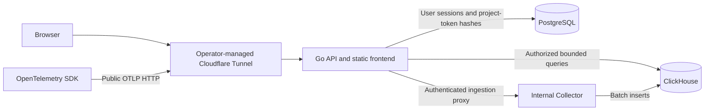

# Logice stack decisions

## Status and scope

This document records stack selection and feasibility, not a production release. At revalidation base `b665784`, the template migration, local Go query API, React trace/log views, web/API containers, and Python examples exist. Authentication, multi-project authorization, production migrations, and public deployment remain unimplemented. The local implementation does not close the later production acceptance gates.

The user confirmed self-hosting, one organization per deployment, Go, React with TypeScript, PostgreSQL for application data, ClickHouse for telemetry, Radix, the authentication methods, and Cloudflare Tunnel. The remaining library selections and operating targets below are recommendations submitted for acceptance in this pull request. Do not treat a successful feasibility test as user acceptance or production readiness.

## Selected implementation workflow

1. An administrator creates a project and issues an ingestion token.
2. An instrumented application sends OTLP traces and correlated logs.
3. A signed-in user selects an authorized project and time range.
4. The explorer shows a time histogram and expandable trace/log rows.
5. Selecting a trace shows its parent/child spans, attributes, correlated logs, and aligned duration bars.

Metrics, arbitrary SQL, alerts, billing, dashboards, and LLM-specific views are outside the first release. The supplied screenshot is a design reference, not a requirement to implement every control.

### Proposed release validation budget

These are test targets, not measured capacity claims or a promise about the user's workload:

- Use a reference host with 4 CPU cores, 8 GiB RAM, and SSD storage. Measure disk use before selecting a production disk size.
- Test 100 events/second for 10 minutes, then a 1,000 events/second burst for 30 seconds. Count traces and log records separately and report accepted, persisted, rejected, and missing records.
- Begin with 7-day telemetry retention. Test queries against at least 1 million events, including late and out-of-order spans.
- Target p95 bounded-query response time below 2 seconds and data visibility within 5 seconds when the database is healthy. Measure rather than assume these targets pass.
- Bound explorer pages to 200 rows, trace expansion to 5,000 spans, and query duration to 5 seconds. Show truncation explicitly; never silently display a partial trace as complete.
- Reject compressed request bodies above 10 MiB and decoded payloads above 32 MiB. Test both limits before public ingestion is enabled.

The integration suite uses small functional fixtures. Local browser workflows are tested separately, but neither suite runs this proposed load, retention, or large-tree budget. The local API caps lists at 100 records and detail at 500 spans/200 logs; these are validation bounds, not approval of the proposed release limits.

## Component decisions

| Area | Selection | Reason and evidence |
| --- | --- | --- |
| Runtime | Go; standard-library `net/http` | One application process; no server framework required. The language version is Go 1.26; CI and the API build use patched Go 1.26.10. See the certificate-distrust revalidation in `validation.md`. |
| PostgreSQL | 18.6, `pgx/v5` 5.11.0 | Transactional application data; native driver verified in the feasibility test. |
| ClickHouse | 26.8.30.8 LTS, `clickhouse-go/v2` 2.49.0 | Append-oriented telemetry and aggregations; verify schema and queries against this pinned server. |
| Collection | Collector Contrib 0.163.1 | OTLP HTTP and gRPC, authentication, resource enrichment, bounded batching, and retries. Traces/logs exporter stability is beta; metrics are alpha. |
| Migrations | Goose 3.29.0 | Separate database histories. PostgreSQL uses transactions; ClickHouse migrations require `NO TRANSACTION` and explicit recovery. Feasibility fixtures are not the production application schema. |
| Frontend | React 19.3.1, TypeScript, Vite 8.3.4 | Browser application; no SSR requirement. Node 26 satisfies Vite's published engine range. |
| Navigation and data | TanStack Router 1.170.45, Query 5.104.4 | Typed routes, request cancellation, caching, and polling. Start with code-defined routes rather than additional route-generation tooling. |
| Explorer rows | TanStack Virtual 3.14.21 | Render visible flattened tree rows. Add TanStack Table only if the column model needs it. |
| UI | Radix Themes 3.3.0, Colors 3.0.0, Icons 1.3.2; individual Primitives as needed | Published Themes and Icons peer ranges include React 19. Use Themes tokens first and CSS Modules for application-specific layout. No Tailwind or shadcn/ui. |
| Browser API | REST, OpenAPI, `openapi-typescript` 7.13.0 | Generate frontend contract types; validate Go handlers against the same contract. OTLP is a separate ingestion protocol. |
| Quality | Biome, Vitest, Go tools, Playwright 1.64.1 | Keep unit tests with source; browser tests and Playwright configuration belong in `web/`. |
| Deployment design | Docker Compose, operator-managed Cloudflare Tunnel | No Kafka, Redis, Kubernetes, or bundled identity service. The proposed production design serves assets in Go. Current local containers use Nginx for static files and API forwarding; this does not select Nginx for production. |

Versions are validation pins observed on 2026-10-18, not a policy to stay on these versions indefinitely. The Go lockfile records actual resolved versions. Frontend registry metadata was checked with `npm view`. A disposable fixture also installed and built the selected React/Radix/TanStack packages, ran a unit test, and collected Playwright tests from `web/e2e/` using only `web/` dependencies. It did not launch a browser or implement the application frontend.

## Application boundaries

- Serve the browser API and frontend under one origin. The operator supplies the stable public URL before OIDC setup or passkey enrollment; no actual hostname is selected by this document.
- Keep `cloudflared` outside Logice's Compose project initially. The operator controls the existing tunnel and credentials. Do not change an existing tunnel during validation.
- Keep database, Collector, and health ports private in production. The feasibility Compose file publishes **loopback-only** ports: a fixed web port 5173 and random database/Collector ports; do not tunnel that file directly.
- Public ingestion initially uses OTLP/HTTP. Local gRPC is part of the feasibility proof. Do not advertise public OTLP/gRPC through Cloudflare until its transport and authentication path pass an integration test.
- Trust forwarded scheme/address headers only from the configured tunnel proxy. Use the configured external URL, not an arbitrary Host header, for redirects and authentication origins.

### Ingestion identity and isolation

The current proof has one token and a fixed trusted project ID, `validation`. It proves replacement of a client-supplied resource project ID, not dynamic project authorization.

For the application implementation:

- Generate high-entropy project tokens; store only their SHA-256 hashes, project association, expiry, and revocation state in PostgreSQL. Show the raw value once.
- Authenticate every public ingestion request in the Go reverse proxy. Reject revoked tokens and database failures before forwarding. Do not add a token cache initially.
- Remove all client-supplied reserved project headers. Set one trusted project header from the authenticated database record, and replace the upstream Authorization value with an internal Collector credential.
- Let the Collector receive and decode OTLP; the Go proxy does not implement a second telemetry parser. Preserve upstream OTLP response bodies and status codes, including partial-success responses.
- Enable receiver metadata and copy the trusted project header into resource attributes before any batching. Delete the client project resource attribute first. Fail closed when the authenticated project is absent; never retain a client value as a fallback.
- Verify this metadata-enrichment path with the pinned Collector before adopting it. Test two projects, conflicting headers and attributes, missing project context, token revocation, and attempted direct Collector access.
- Authorize every telemetry query against project membership. Use parameterized project/time filters even for trace-ID lookup. Trace IDs are identifiers, not access tokens.
- Use distinct production database roles for migrations, ingestion inserts, and read-only telemetry queries. The broad bootstrap roles in the proof are not production roles.

Collector resource context support is documented in the [resource processor](https://github.com/open-telemetry/opentelemetry-collector-contrib/blob/v0.163.0/processor/resourceprocessor/README.md). The dynamic proxy integration is still an application acceptance test, not a verified property of the static proof.

### Retention and failure behavior

- The proof creates default exporter tables with a 24-hour TTL. Exporter-managed DDL is acceptable only in this disposable environment.
- Adopt explicit versioned production DDL, set `create_schema: false`, and preserve the exporter's required column names/types. Add project-aware indexing only after representative query measurements. Changing the Collector version does not automatically migrate existing tables.
- Use exporter queue batching after project enrichment. The proof has 100 in-memory queue entries, two consumers, a 2,048-item maximum batch, and a 1-second flush timeout. Memory limiting starts at 128 MiB; the container limit is 256 MiB.
- Retry transient ClickHouse failures for up to 300 seconds with 1-to-5-second backoff. Queue overflow, memory pressure, permanent export errors, expiry of the retry budget, and Collector restart can lose accepted data.
- A successful OTLP response does not mean durable persistence. The proof is not lossless or exactly-once. Retries can produce duplicates; consumers must not assume unique rows.
- Do not add a durable queue until the release's accepted data-loss budget requires one. Before public release, measure queue saturation, duplicate behavior, shutdown flushing, and backpressure, and document any remaining loss window.

## Build and migration design

Use the repository structure in the current plan and the dependency-ordered tasks in [implementation.md](implementation.md). Build frontend assets separately and copy them to `/app/web/dist/`; copy SQL to `/app/migrations/{postgres,clickhouse}/` and a pinned Goose CLI to `/app/goose`. The initial design does not use `go:embed`. Go builds and unit tests must work without a frontend build.

Before production implementation, resolve migration ownership and serialize each deployment's migrations. PostgreSQL and ClickHouse cannot share a transaction. Apply compatible schema additions before changing writers. Stop rollout on either database's migration failure; do not automatically run destructive down migrations.

## Recovery and risks

- Keep local proof data in named volumes. Ordinary `docker compose down` preserves them. The isolated test deletes only the volumes for its own randomly named project.
- Do not run `down --volumes` against a real deployment. Do not run test migrations against existing databases.
- Before production schema changes, back up PostgreSQL and ClickHouse and verify restore on separate storage. Preserve the TOTP encryption key separately from database backups; losing it can make enrolled factors unusable.
- Restore databases to a mutually compatible schema/application version. Prefer forward corrective migrations for partial ClickHouse DDL. A previous executable may be used only while schemas remain backward-compatible.
- The first implementation must demonstrate backup/restore, key recovery, and migration-failure handling before release. No production backup or recovery operation is performed by this validation PR.

## Pending acceptance

Previously confirmed choices remain confirmed: self-hosting, one organization, Go, React/TypeScript, the database split, Radix, the authentication methods, and Cloudflare Tunnel. Do not request those decisions again.

Only the remaining recommendations require an explicit user acceptance record:

| Recommendation | Decision record |
| --- | --- |
| Supporting libraries and contracts | The component selections above, including TanStack, REST/OpenAPI, Goose, and the authentication candidates in `authentication.md`. |
| Authentication policy | Invitation-only access, local bootstrap/recovery, session lifetimes, and the proposed per-login-method TOTP policy in `authentication.md`. |
| Operating and validation targets | Hardware/disk budget, seven-day retention, request/result bounds, ingestion-loss policy, and the numeric test budget above and in implementation stage 0. |

The responsible role is the user reviewing the revalidation PR. Record acceptance or specific changes there, then link that evidence in the tracked plan. Execution authorization, a merged feasibility PR, automated review, or approval of a UI preview is not an explicit acceptance of all these recommendations. The current plan must remain open until its existing acceptance condition is met. Unresolved recommendations block their dependent production stages, not the already authorized local proof.

The hostname, identity-provider registration, tunnel credentials, and backup/key custody are operator inputs for later deployment. No operator action, public transport compatibility, or release readiness is claimed here.

## Decision evidence and limits

- Container tags were pulled successfully for the three pinned images. The integration result and exact commands belong in [validation.md](validation.md).
- Published Go module metadata and frontend registry peer/engine ranges support the library choices; they are not a substitute for application integration tests.
- [Authentication design](authentication.md) preserves all required password, WebAuthn, TOTP, and Pocket ID test cases. Pocket ID discovery compatibility is not proof of login compatibility.
- Final acceptance of the recommended libraries and operating targets remains a pull-request review gate. Keep the current plan until that acceptance and every completion check are supported by evidence.
